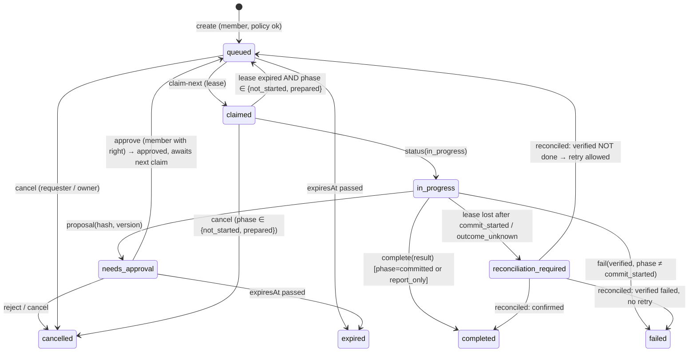

# Review package — OurPawmily Agent Integration Hub + Muse Action Bridge (M0, design only)

**For:** independent architecture / security / privacy / product review (Deputy Chief Engineer role).
**From:** Claude (Chief Engineer). **Owner:** the household's product owner (final authority).
**Status:** design only — nothing implemented, merged or deployed. Implementation waits for the owner's approval after this review.
**Private data classification:** none — no credentials, keys, family data or personal details. Example names are Sam (owner) and Pat (partner).

## What is being proposed (summary)
- **Option B:** build the Muse "Household Agent" bridge first, on a small shared core that becomes the generic Agent Integration Hub — rather than building a generic hub first.
- **Two separate stores on one shared core:** a household store per family (Muse; never source code) and an engineering store per owner (Claude/ChatGPT review; never family data).
- **Muse polls Pawmily** (custom connector over REST/OpenAPI + a scoped key; no inbound Muse API exists). Pawmily owns all safety: who may ask, spending limits, approvals bound to the exact proposal, a "commit-intent" step before anything irreversible, and reconciliation instead of blind retries.
- **Claude ↔ ChatGPT reviews are pulled by the agent when the human asks**, with human approval to share and to return; fallback is export/paste.

## Questions for the reviewer
1. Is Option B (Muse first, shaped as the core) right, or should the generic hub come first?
2. Is the commit-intent + reconciliation design enough to prevent duplicate bookings/purchases when Muse loses contact mid-action? What's missing?
3. Is keeping Muse's execution record separate from the generic task (composition) the right call?
4. Are the capability lists (§8 of the hub design) tight enough? Any path for an agent to escalate, read family data, or approve its own work?
5. Is splitting household and engineering into separate stores worth it, or overkill for one household?
6. Are the approval gates (share, return, requester, owner spend, commit) the right ones — too many, too few?
7. What would you cut to make the first build smaller without losing safety?
8. Any privacy concerns with plaintext tasks going to Meta (household) and review packages going to OpenAI?

## Key assumptions (please challenge)
- Consumer Muse can call a custom connector from a scheduled task without a person in the chat, often enough (≈10–15 min) for coffee orders.
- Muse follows a claim → work → approval → commit-intent → complete protocol from an OpenAPI description.
- ChatGPT may only be able to *read* via MCP on Plus/Pro (reports conflict); the review can come back by paste.
- No provider lets an outside system post into an existing personal chat.

## Known risks
- Muse polling interval and unattended behaviour are unverified (step 0 is a harmless stub test).
- A reported OAuth failure with some Claude custom-connector setups.
- Some data necessarily leaves unencrypted (household tasks to Meta, review packages to OpenAI).
- Prompt injection via returned reviews or email-like inputs — reviews are treated as notes, never instructions.

---

# Part 1 — Agent Integration Hub (docs/agents/HUB_M0_DESIGN.md)


## 0. Findings that shape the design (verified 2026-10-31)

| Platform | What's officially available | Implication |
| --- | --- | --- |
| **Claude (claude.ai, Desktop)** | **Custom connectors = remote MCP servers** on Pro/Max/Team/Enterprise (Settings › Connectors › Add custom connector), with authless or OAuth auth. Claude Code also takes MCP servers. ([Anthropic help](https://support.claude.com/en/articles/11503834-building-custom-connectors-via-remote-mcp-servers)) | Claude can *pull* a review result from the Hub with a tool call when Sam asks it to. |
| **ChatGPT** | **Developer Mode** adds custom remote MCP connectors (HTTPS only), with confirmation prompts before write actions. **Which plans may use write actions is reported inconsistently:** some sources say Plus/Pro are read/fetch-only, others say write actions are available. ([Boomi](https://help.boomi.com/docs/Atomsphere/Platform/Connect_chatgpt_setup), [InfoQ](https://www.infoq.com/news/2025/10/chat-gpt-mcp), [Obot](https://obot.ai/?p=3333)) | ChatGPT can *read* a review package via MCP. Whether it can *submit* a review by tool on Sam's plan must be checked. The fallback is that Sam pastes the review into the Hub's form. |
| **Meta Muse** | Custom connectors via **OpenAPI or MCP URL** set up in chat; scheduled tasks; no inbound API (see Muse M0 §3). | Muse polls the Hub over REST. |
| **Injecting into an existing personal chat (any provider)** | **Not supported anywhere.** An API model session is not your ChatGPT/Claude conversation. | Every handoff is **pull-based and human-started**: the Hub holds the package, and Sam tells the agent "check the review inbox". This also satisfies "human-mediated, no loops" by construction. |
| **Repo** | No MCP code exists (only a mention in `docs/FUTURE_FEATURES.md`). The Worker routes everything through `familyApi`; KV, R2, and a SQLite Durable Object (`ChatHub`) for atomic per-family state. | The Hub is a small module plus a Durable Object, not a framework. |

Primary vendor pages were partly unreachable from this session. The plan-tier question for ChatGPT
write actions and Muse's polling details are the main open checks (§19).

## 1. High-level architecture

**Two trust domains on one shared core.**

- **Household domain** (`AgentHub` Durable Object, one per family): Muse and future household
  executors. It touches household tasks and **never** source code.
- **Engineering domain** (`EngineeringHub` Durable Object, one per owner account, **not per family**):
  Claude and the ChatGPT review bridge. It holds review packages made from repo material and
  **never** family data.

Both use the same small core library (`js/agentCore.js` + `server/agentHub.js`):
- integration registry and capability check;
- task envelope, state machine helpers and validators;
- approval gates, credential handling and audit.

The domains are deliberately separate stores, so a leaked review-connector credential cannot reach
household tasks, and vice versa.

## 2. Component diagram

```
                          SAM (human authority)
                 approves shares · returns · spend · scopes
                                   │  (Pawmily session, Me › Connected agents)
                                   ▼
┌──────────────────────── Worker (connector) ─────────────────────────────┐
│  member routes /v2/agents/*         integration routes /v2/agents/int/* │
│        │                                       │            MCP adapter │
│        ▼                                       ▼               /v2/mcp  │
│  ┌──────────── Agent core (shared code, no state) ───────────────────┐  │
│  │ Registry · Capabilities · TaskService · Approvals · Router · Audit│  │
│  └──────┬───────────────────────────────────────────────┬───────────┘  │
│         ▼                                               ▼              │
│  AgentHub DO (per family)                      EngineeringHub DO (per owner)
│  • integrations (Muse…)                        • integrations (Claude, ChatGPT)
│  • tasks + ExternalActionExecution             • tasks + ReviewPackage/ReviewResult
│  • audit                                       • audit
└─────────┬──────────────────────────────────────────────┬───────────────┘
          │ REST/OpenAPI (Muse polls)                    │ MCP (Claude/ChatGPT pull when Sam asks)
          ▼                                              ▼
        Muse                                   Claude · ChatGPT
```

## 3. Data flow

**Engineering review: human-mediated, pull-based.**

```
Claude (this repo session) ──submit_for_review(package)──▶ EngineeringHub: awaiting_share_approval
Sam opens Me › Connected agents ──[Review and share]──▶ shared (visible to the ChatGPT integration only)
Sam in ChatGPT: "check the Pawmily review inbox" ──get_review_package──▶ ChatGPT reads it
ChatGPT ──submit_review(result)──▶ awaiting_return_approval
   (fallback if ChatGPT can't write: Sam pastes the review into the Hub's form)
Sam ──[Send to Claude]──▶ returned
Sam in Claude: "pick up the review" ──get_review_result──▶ Claude reads it → closed
```

**Household action** (unchanged from the Muse M0 design): Talk → minimum task → policy → `AgentHub`
→ Muse claims → executes → result, with approvals and reconciliation per Muse M0 §11–13.

Nothing moves between domains. Family data never enters a review package; source code never enters
a household task.

## 4. AgentIntegration model

```jsonc
{
  "id": "int_…", "domain": "household" | "engineering",
  "scopeOwner": { "familyId": "fam…" } | { "accountId": "g…" },     // where it lives
  "provider": "meta" | "anthropic" | "openai" | "direct_api" | "manual",
  "integrationType": "external_action_executor" | "engineering_builder" | "engineering_reviewer",
  "role": "external_action_executor" | "chief_engineer" | "deputy_engineer",   // product role, not provider
  "displayName": "Sam's Muse",
  "ownerMemberId": "m_sam",
  "allowedRequesterMemberIds": ["m_sam", "m_pat"],                 // household only
  "capabilities": ["external_actions.claim", "external_actions.update", "external_actions.complete", "external_actions.request_approval"],
  "transport": "rest" | "mcp" | "manual",
  "credential": { "kind": "bearer" | "oauth", "hash": "…", "hint": "…x9Qa", "expiresAt": "…" },
  "enabled": true, "health": { "lastContactAt": null, "lastSuccessAt": null },
  "createdAt": "…", "updatedAt": "…", "expiresAt": null, "revokedAt": null, "version": 1
}
```

The role is separate from the provider. Swapping who plays `deputy_engineer` is just a different
integration with the same role.

## 5. AgentTask model (the generic envelope)

```jsonc
{
  "id": "task_…", "schemaVersion": 1, "domain": "household" | "engineering",
  "taskType": "external_action" | "architecture_review" | "pr_review" | "implementation_request" | "research",
  "sourceIntegrationId": "int_claude" | null,       // null = a person (Talk) created it
  "targetIntegrationId": "int_chatgpt" | "int_muse",
  "requestedByMemberId": "m_sam", "affectedMemberIds": ["m_sam"],
  "payloadType": "ReviewPackage@1" | "ExternalAction@1",   // typed, versioned, validated
  "payloadRef": "exec_…" | "pkg_…",                 // composition: the typed record lives beside the task
  "contextRefs": [{ "kind": "pr", "ref": "cryptonomicon46/DietApp#24" }],
  "status": "…", "priority": 0, "approvalPolicy": "…",
  "createdAt": "…", "updatedAt": "…", "expiresAt": "…", "version": 1
}
```

**Generic lifecycle** (review and other non-financial work):

```
draft → awaiting_share_approval → available → claimed → in_progress → awaiting_review
      → awaiting_return_approval → completed
(any non-terminal) → cancelled | expired ; claimed/in_progress → failed
```

Terminal states are final. Every transition is versioned, and illegal ones return 409.

## 6. Review-task model

```jsonc
// ReviewPackage@1 — bounded; assembled by Claude, shown to Sam before sharing
{ "title": "Muse Action Bridge — M0", "purpose": "architecture review",
  "summary": "…", "designDocument": "<markdown, ≤ 200 KB>",
  "changedFiles": ["docs/muse/M0_DESIGN.md", "…"], "relevantDiffs": "<unified diff, ≤ 200 KB>",
  "assumptions": ["…"], "knownRisks": ["…"], "questionsForReviewer": ["…"],
  "privateDataClassification": "none" }        // must be "none" to share (validator + secret scan)
// ReviewResult@1 — structured enough for Claude to act on
{ "overallAssessment": "approve_with_changes", "blockers": [{ "id": "B1", "text": "…", "where": "…" }],
  "highPriorityIssues": [], "recommendations": [], "optionalImprovements": [],
  "acceptedAssumptions": [], "disputedAssumptions": [], "approvalRecommendation": "approve | changes | reject",
  "prose": "<markdown>" }
```

**Package guards, applied before `awaiting_share_approval`:**
- a size cap;
- `privateDataClassification` must be `none`;
- a secret and PII scan, reusing the sensitive-text patterns from the voice PR and checking for keys,
  tokens, emails and household names;
- no whole-repo dumps (`changedFiles` ≤ 50).

**Approval states:** `created → awaiting_share_approval → shared → reviewed →
awaiting_return_approval → returned → closed`. These map onto the generic statuses above.

## 7. Muse-specialised task relationship: Option B, composition

- An `AgentTask` with `taskType: external_action` **links to** an `ExternalActionExecution` record.
  That record is the Muse M0 `AgentRequest`, unchanged in substance: leases, execution phase,
  commit-intent, `outcome_unknown`, `reconciliation_required`, proposal hash, idempotency, spending
  constraints.
- The generic task status only **mirrors** the execution for listing and UI. The execution record's
  state machine is authoritative, and the generic router can never move it.

**Why not Option A** (Muse fields folded into the envelope)? It would either weaken the irreversible-
action rules to fit review tasks, or burden every task with lease and commit fields.

## 8. Capability and scoping model

| Integration | Capabilities (exhaustive) | Can never |
| --- | --- | --- |
| Muse | `external_actions.claim`, `.heartbeat`, `.update`, `.request_approval`, `.commit_intent`, `.complete`, `.fail`, `.reconcile` | read any family record, read source, see other integrations |
| ChatGPT (reviewer) | `review.read_shared_package`, `review.submit_result` | read unshared packages, read results, create tasks, touch household |
| Claude (builder) | `review.submit_package`, `review.read_returned_result`, `review.list_own` | read household, approve its own share, read packages it didn't author |
| Any | none implied by role or provider | escalate scopes, register integrations, approve anything, read credentials |

- Capabilities are checked in **one** place (`can(integration, capability, task)`), server-side, on
  every call.
- Only Sam, via a member session as the owner, can create integrations, change capabilities or
  approve.
- Integration credentials never reach a browser.

## 9. Approval model

**One `Approval` record type:**

```jsonc
{
  "taskId": "…",
  "gate": "share | return | spend | commit | requester",
  "subjectHash": "…",        // the exact package, result or proposal
  "approvedBy": "m_sam",
  "decision": "approve | reject",
  "at": "…"
}
```

- **Bound to `subjectHash`:** any change to the package, result or proposal voids the approval.
- **Engineering gates:**
  - `share`: Sam approves before ChatGPT can read;
  - `return`: Sam approves before Claude can read.
- **Household gates** (Muse M0 §13, unchanged):
  - `requester` and `spend`, with owner spending separate from requester confirmation;
  - commit gating via commit-intent.
- **Loop prevention:** a review task can't create another task. Claude has to make a new submission,
  which needs a fresh share approval. Optionally, a per-day cap on shares.

## 10. Credential model

**Per integration, never shared:**
- **Bearer** (Muse, and MCP connectors that use API keys): 32 random bytes, shown once, stored as an
  HMAC with a Worker pepper; scoped, expiring (90 days default), rotatable with a 10-minute overlap,
  revocable, and rate-limited per integration.
- **OAuth 2.1** (preferred where the client supports it): Claude custom connectors support OAuth,
  including Dynamic Client Registration.
  - Pawmily would act as its own small authorization server **only for the engineering domain**.
  - Consent is shown to Sam and scoped to that integration's capabilities.
  - There is a reported Claude OAuth edge case to test (§19).
- **Never logged:** Authorization headers, tokens, client secrets or peppers.
- **The audit log** records `credential_issued`, `credential_rotated` and `integration_revoked` with
  hints only.

## 11. MCP adapter design

- **Shape:** one remote MCP endpoint per domain, using the Streamable HTTP transport:
  - `/v2/mcp/engineering`, for Claude and ChatGPT;
  - later, possibly `/v2/mcp/household` for Muse, if MCP proves better than REST there.
- **Tools are a projection of the caller's capabilities.** `tools/list` returns only what this
  integration may call:
  - **reviewer:** `list_shared_reviews`, `get_review_package`, `submit_review`;
  - **builder:** `submit_for_review`, `list_my_reviews`, `get_review_result`;
  - **household (later):** `claim_external_action`, `heartbeat_external_action`,
    `request_approval`, `commit_intent`, `complete_external_action`, `fail_external_action`,
    `reconcile_external_action`.
- **Mark read-only tools** with `readOnlyHint`. ChatGPT asks for confirmation on the rest, which
  suits the human-in-the-loop model.
- **No** `execute_arbitrary_action`, no generic `query`, no `list_all_tasks`.
- Every tool calls the same `TaskService` method as its REST twin. MCP and REST have no separate
  state.

## 12. REST adapter design

Following repo conventions (all under `/v2`, in an `agentRoutes()` module like `voiceRoutes`):

| Who | Routes |
| --- | --- |
| Member (Sam) | `GET/PUT /v2/agents/integrations`, `POST …/integrations/{id}/credential` (once), `DELETE …/credential`, `GET /v2/agents/tasks`, `POST /v2/agents/tasks/{id}/approve` and `/reject` (gate + subjectHash), `POST /v2/agents/reviews/{id}/paste-result` (manual fallback) |
| Integration (bearer/OAuth) | household (from Muse M0): `/v2/agents/int/external-actions/claim-next`, `…/{id}/heartbeat`, `/status`, `/commit-intent`, `/complete`, `/fail`, `/reconcile`; engineering (REST twin of the MCP tools): `/v2/agents/int/reviews/…` |

Errors use one JSON shape, `{ "error": { "code", "message" } }`.

## 13. Routing model

`AgentRouter.route({ domain, taskType, requester })` → `{ integrationId } | { none, why }`:
1. Candidates: enabled integrations in that domain whose **role** handles the `taskType`, e.g.
   `architecture_review` → `deputy_engineer`, `external_action` → `external_action_executor`.
2. Filter by requester authorization (household) or ownership (engineering), capability, and health.
3. Pick the owner's default for that role. With one candidate, it's automatic.
4. **External actions:** the router only *selects* the executor. Creating the execution still goes
   through the Muse policy checks and commit gates, which the router cannot skip.
5. A future `direct_api` integration for a task type outranks an agent when present.

## 14. Audit model

**One append-only table per Durable Object:**

```
(id, at, taskId|integrationId, event, actorKind, actorId, meta)
```

- **Events:**
  - `task_created`, `share_requested`, `share_approved`, `shared_to_agent`;
  - `agent_claimed`, `agent_result_submitted`, `return_approved`, `task_closed`;
  - `approval_rejected`, `credential_issued`, `credential_rotated`, `integration_disabled`,
    `integration_revoked`;
  - plus the Muse execution events from Muse M0 §19.
- **`meta`** holds ids, hashes, sizes, counts and status only, **never payload text**, secrets,
  payment details or family data.
- **Retention:** 1 year for the engineering domain; household follows the family's data lifetime and
  is deleted with the family.

## 15. Failure and degradation behaviour

| Unavailable | Product effect | What the user gets |
| --- | --- | --- |
| ChatGPT integration (disabled, not connected, can't write) | Nothing breaks | **Export review package** (copy or download markdown) and **Paste review** (manual return), with the same approvals and audit |
| Claude integration | Nothing breaks | "Save implementation request". The package stays in the Hub until Claude next pulls it |
| Muse | Talk works; no external execution | "Household Agent unavailable"; the task can be prepared and saved; "do it yourself in Muse" as advice only |
| The Hub itself (Durable Object error) | Every other app feature unaffected | Agent features show "unavailable", fail closed |

## 16. Provider-disable strategy

- **Per integration, in Me › Connected agents:**
  - **Pause** (`enabled=false`): calls are refused, and data and credential are kept.
  - **Revoke credential:** refused immediately.
  - **Remove:** the integration and credential are deleted, and the audit is kept.
- **Operator kill switches**, Worker vars like the voice PR's `CLOUD_VOICE`:
  - `AGENTS_HOUSEHOLD=off`
  - `AGENTS_ENGINEERING=off`
- **No feature imports a provider directly.** Talk asks the router, and review screens ask the
  TaskService, so a missing provider is just "none".

## 17. Migration path from the current Muse proposal

| Existing Muse concept | → Hub component | Stays specialised? |
| --- | --- | --- |
| `ExternalAgentIntegration` | `AgentIntegration` (`domain: household`, `role: external_action_executor`, `provider: meta`) | No, generalised |
| Muse credential (`pmk_…`) | integration credential (bearer) | No |
| Scopes `agent.requests.*` | capabilities `external_actions.*` | No |
| `ExternalActionRouter` / `MuseActionProvider` | `AgentRouter` + provider adapter | No |
| `AgentRequest` | `AgentTask` envelope **+ linked `ExternalActionExecution`** | **Yes, the execution record** |
| Leases, `claim-next`, heartbeat | `ExternalActionExecution` | **Yes** |
| `executionPhase`, commit-intent, `outcome_unknown`, `reconciliation_required` | `ExternalActionExecution` | **Yes, non-negotiable** |
| Proposal hash and approval binding | generic `Approval` with `gate: commit/spend/requester` and `subjectHash` | No (the record is generic; the rules stay Muse's) |
| Household Agent policy (per action class, limits, owner approval) | `integration.policy`, evaluated by the external-action service | **Yes, the evaluation** |
| Requester / beneficiary / owner | `requestedByMemberId` / `affectedMemberIds` / `ownerMemberId` | No |
| Audit events | generic audit table (Muse events included) | No |
| Household Agent settings and activity UI | Me › Connected agents › Muse | No (it's one row) |

Nothing in the Muse M0 design is dropped.

## 18. Build now vs defer

**Recommendation: Option B.** Build Muse's minimal infrastructure first, shaped so that it *is* the
generic core. Don't build a framework ahead of its first user.

| Now (with the Muse bridge) | Deferred |
| --- | --- |
| `agentCore`: registry, capability check, task envelope, generic `Approval`, audit table, credential service, router with one rule | Engineering domain (`EngineeringHub` DO), until the review bridge is authorized |
| `AgentHub` DO (household) + `ExternalActionExecution` + Muse REST/OpenAPI | MCP adapter for household, unless Muse shows REST is inadequate |
| Me › Connected agents (one row: Muse) | Claude/ChatGPT rows, OAuth server, review screens |
| Kill switch `AGENTS_HOUSEHOLD` | `direct_api` provider |

**Why B:**
- There's a real first user.
- The generic pieces are small: maybe 300 lines of core code.
- The Muse-specific safety code is written once, in the right place.
- A Hub-first PR would ship code nobody calls and would have to guess the review bridge's needs.

## 19. Risks and unknowns

1. **ChatGPT write actions on Sam's plan.** Sources conflict. If ChatGPT is read-only, the review
   returns through **Paste review**, which is already designed.
2. **Claude custom-connector OAuth.** A reported auth failure with some OAuth 2.1 setups. Test a
   bearer/authless-plus-token variant as a fallback, and prefer OAuth only once it's proven.
3. **Muse:** polling interval, unattended connector calls and protocol fidelity (Muse M0 §20).
4. **Data leaving the trust boundary:** review packages go to OpenAI; household tasks go to Meta. Both
   are plaintext by necessity and must be stated on the privacy page. Mitigations are the package
   scanner and the share approval.
5. **Prompt injection through returned reviews.** Claude must treat a ReviewResult as *data from a
   peer*, not instructions. The Hub labels it as such, and changes still go through normal PR review
   and CI.
6. **Scope creep into an "agent platform".** Mitigated by the "Can never" column (§8) and no generic
   tools.
7. **Cost:** consumer Claude and ChatGPT pulls use Sam's subscriptions, not API credits. The Hub
   itself costs little: Durable Object storage on the current plan.

## 20. Recommended branch and PR sequence

1. **`v2/muse-bridge`** (after this M0 and the Muse M0 are approved): `agentCore`, `AgentHub` DO,
   `ExternalActionExecution`, Muse REST/OpenAPI, Me › Connected agents (Muse row).
   - Stage 0 smoke test against a logging stub first.
   - The PR stays unmerged for independent review.
2. **`v2/review-bridge`:** the `EngineeringHub` DO, ReviewPackage/ReviewResult, share and return
   approvals, **export/paste fallback first**, then the engineering MCP endpoint and Claude/ChatGPT
   rows.
   - Verify ChatGPT write capability on Sam's plan before relying on `submit_review`.
3. **`v2/agents-mcp-household`:** only if Muse needs MCP.
4. **`direct_api` providers:** per merchant, only where a real API exists.

Each PR:
- passes CI;
- keeps every provider optional;
- is deployed only with explicit approval.

---

# Part 2 — Muse Action Bridge (docs/muse/M0_DESIGN.md)


## 1. Architecture summary

Pawmily turns a request into a **bounded, minimal task**, applies **household policy**, and puts it
on a **per-family request queue**. Sam's Muse, configured once with a custom connector that points at
Pawmily's OpenAPI and a scoped bearer credential, **polls outbound** on a schedule:
1. claims the next eligible task with a lease;
2. does the real-world work with its own accounts and payment methods;
3. pauses for approval when policy says so;
4. writes progress and results back.

Pawmily shows them in the same Talk card and keeps an append-only audit trail.

```
Pat's / Sam's phone ──(Pawmily session)──▶ Worker /v2/agent/*  (user-authenticated)
                                               │ validate · minimise · authorise · route
                                               ▼
                                     ExternalActionRouter ──▶ MuseActionProvider
                                               │
                                               ▼
                                AgentHub (Durable Object, one per family, SQLite):
                                requests · events (append-only) · integration · policy
                                               ▲
Sam's Muse (scheduled task) ──(integration bearer, scoped)──▶ Worker /v2/agent/muse/*
                                                    claim-next · heartbeat · status · complete
```

**Principle:**
- Pawmily knows the family's context and decides what, who, whether and within what limits.
- Muse handles the outside world: websites, connected accounts, merchants and payment.
- Muse never reads Pawmily's family data. It reads only the tasks delegated to it.

## 2. Repo components to reuse (audited 2026-10-31 on `main` `9e6cb18`)

| Need | Reuse | Where |
| --- | --- | --- |
| HTTP routing, CORS, JSON errors | `familyApi` dispatch; a `agentRoutes()` module like `voiceRoutes` / `travelRoutes` | `server/family.js`, `server/worker.js` |
| Member auth and family scoping | Google sign-in, KV sessions, `loadFamily()` / `meIn()` membership checks, `relation: child` limits | `server/family.js` §4 of `docs/ARCHITECTURE.md` |
| Atomic, consistent per-family state | **Durable Object with SQLite**, like `ChatHub`: one per family (`idFromName(fid)`), single-threaded, so claim-next and leases are naturally atomic | `server/chatHub.js` |
| Rate limits | `underLimit(db, key, max, ttl)` | `server/family.js` |
| Notifications (approval needed, done) | `sendTo()` and `NOTIFY_KINDS` (add `agent`) | `server/push.js` |
| Talk intent → typed cards, approve-first | `js/talkParse.js` (phone reader), `tidySteps`, `js/talkActions.js` `ACTIONS` / `validate()` / `modeOf()`, `family/talk.js` cards, `go()` with Undo | |
| AI for the unusual phrasing (allowlisted fields, audit, no values logged) | `server/aiGateway.js` purposes (add `agent.task`) | |
| Minimum-context derivation from private data | the day-question pattern: the phone builds facts and the connector sees only what's needed (`js/talkDay.js`); free-time gaps already computed (`freeTime`) | |
| Signed, scoped, expiring tokens; secrets only on the connector | the speakable-ticket design on PR #19 (HMAC, purpose binding, nonce); the `wrangler secret` conventions | `server/voiceTts.js` (PR #19, unmerged) |
| Optional provider, master switch, one router | PR #19's `routeVoice`, master state and provider-neutral profile pattern | `family/voice.js`, `server/voiceTts.js` |
| Settings surfaces | Me tab sections (✨ Next up & reminders, 🔔 Notifications) for **Household Agent**; owner-only controls like the family's *Cloud voice* | `family/app.js` `meView` |
| Tests | `node --test` with in-memory KV/env, `familyApi` called directly (like `tests/voice.test.js`) | `tests/` |
| Deploy | Pages from `main`; Worker by `pawdeploy`; CI "Check" (tests, links, perf budget) | `CLAUDE.md` |

**Gaps found:**
- KV is last-write-wins, which is unfit for queues and leases. So the agent state lives in a Durable
  Object.
- The E2EE model needs one explicit, documented exception (§14).

## 3. Current Meta Muse custom-connector capabilities (verification, 2026-10-31)

Primary Meta pages could not be fetched from this session. `parallel.ai` and `cellcog.ai` are outside
the session's allowed network, and I did not retrieve Meta's Help Center page directly. These findings
come from search results, mostly third-party, and **must be re-verified in the Muse app and on Meta's
Help Center before M1**.

| Capability | Finding | Confidence |
| --- | --- | --- |
| Inbound API to invoke a person's Muse from outside | **None documented.** A third-party source states there is no public API for driving your Muse, adding connectors, or reading its skills from outside. | Medium (single source, consistent with all others) |
| Custom connectors | Created **by asking Muse in chat**: name the service and give an entry point, either **API docs/OpenAPI it can read** or a **remote MCP server URL**. No settings form. | Medium–high (several sources) |
| Credential handling | An API key given to a custom connector is kept in Muse's **Secure Credentials Store** and **not shown to the model**. | Medium |
| Meta review of custom connectors | **Not reviewed**: "grant access with caution". A separate **submission** path (`muse.ai/platform`, reported Sept 2026) is for public connectors. | Medium |
| MCP for consumer Muse | **Conflicting.** Some guides show remote MCP with OAuth; another says it is not officially confirmed. OpenAPI is consistently described as working. | Low–medium |
| Scheduled / background work | Meta's help page lists **recurring tasks (daily, weekly or custom interval)** that run in the background until cancelled. The minimum interval is **not stated**. | Medium |
| Usage limits | Usage is metered as **tokens per week**. Frequent polling consumes quota, and the real-world task capacity isn't published. | Low–medium |

**Verdict:**
- No better supported direct-invocation mechanism was found. The outbound polling design is the right
  assumption for now, so **no STOP on that criterion**.
- **Treat as uncertain until verified:**
  - the minimum polling interval;
  - whether a scheduled task can call a custom connector unattended;
  - whether Muse reliably follows a claim → heartbeat → complete protocol across one run;
  - whether Muse can wait for approval within one run, or must exit and resume on a later poll.

## 4. Can consumer Muse do the REST polling/claim flow?

**Probably yes, but this is undocumented as a protocol.** Muse can read an OpenAPI document, call
endpoints with a stored bearer key, and run recurring tasks. What is *not* documented:
- whether a scheduled run can call the connector without a person present;
- how many calls one run may make;
- how long a run may last.

The design therefore assumes the least:
1. **Each run is short and stateless.** Claim one task, work it as far as possible, write status, end.
   The next run resumes from Pawmily's stored state; no memory in Muse is required.
2. **Approval waits across runs.** Muse sets `needs_approval` and ends the run. A later run sees the
   approval (`claim-next` returns approved work first) and commits.
3. **Pawmily owns all safety:** leases, phases, constraints and reconciliation are enforced
   server-side. Muse's cooperation is required only for honest reporting.

**Verification step 0 (before writing code):** create a toy custom connector against a stub that
only logs calls (no family data), and observe:
- polling interval;
- unattended calls;
- call count per run;
- run duration.

## 5. Expected polling and background behaviour

- **Interval:** the shortest custom interval Muse allows. If that is 15 minutes, a coffee "in 20
  minutes" is borderline, and dinner bookings are fine.
- **What the UI says:** "Muse checks for requests about every N minutes", shown in Talk at send time,
  from `lastMusePollAt` statistics. It never promises immediacy.
- **Cost control:** `claim-next` returns **204 No Content** quickly when there's nothing to do. That
  keeps idle polls cheap in Muse tokens.
- **Manual nudge:** the card can say "To start now, open Muse and say 'check Pawmily'". That is plain
  text. **No undocumented `muse://` deep link** will be invented.
- **Presence:** `lastMusePollAt`, `lastMuseClaimAt` and `lastMuseSuccessAt` drive the status label:
  - "Muse connected" when polled within 2× the expected interval;
  - "Muse hasn't checked recently" after that;
  - "Muse not connected" if it never polled.

## 6. Credential storage

**Generation (owner only, in Household Agent settings):**
- 32 random bytes (`crypto.getRandomValues`), shown once as `pmk_<base64url>`.
- Stored only as `HMAC-SHA256(pepper, token)`, where the pepper is a Worker secret `AGENT_TOKEN_PEPPER`.
  It's kept in the integration record with a short non-secret `tokenHint` (the last 4 characters).
- Checked with a constant-time comparison.

**Use:**
- `Authorization: Bearer pmk_…` only, HTTPS only, on `/v2/agent/muse/*` routes.
- It is never accepted on member routes, and member session tokens are never accepted on Muse routes.

**On the Muse side:** the owner pastes the token into Muse's custom-connector setup. Muse keeps it in
its Secure Credentials Store (§3).

**Lifecycle:**
- `expiresAt` defaults to 90 days and is shown in settings.
- **Rotate** issues a new token; the old one is valid for 10 minutes, then dead.
- **Revoke** kills it immediately.
- **Disable integration** stops all Muse routes (403 `INTEGRATION_DISABLED`).
- Rate limit: 120 calls per hour per integration.

**Never logged:** `Authorization` headers, tokens, peppers or family keys. Errors carry codes only.

**Later:** if this ever serves many households, replace personal bearer tokens with OAuth, which
Muse reportedly supports for connectors.

## 7. REST vs MCP

**REST + OpenAPI first.**
- Consistently reported to work for consumer Muse custom connectors.
- Simple to test, and it fits the Worker.

**MCP later**, only if verification shows a practical gain (for example better unattended behaviour).
It would be a thin adapter over the **same `AgentRequestService`** (`claim_next_request`,
`get_request`, `heartbeat_request`, `update_request`, `complete_request`, `fail_request`), with one
state machine, one validator, one store and one audit log.

## 8. ExternalActionProvider design

```
interface ExternalActionProvider {
  id: 'muse' | 'direct' | 'none'
  capabilities(): RequestType[]                 // what it can execute
  available(integration): { ok, why }           // enabled, not revoked, recently polled
  submit(request): void                         // Muse: enqueue (pull model); Direct: call merchant API
}
ExternalActionRouter.route({ requestType, requester, beneficiaries, prefs })
  → { provider, integrationId } | { provider: 'none', why }
```

- **Talk asks only `route()`**, never "Muse". With one integration it is picked automatically when
  policy allows, so you never choose an agent each time.
- **Fallbacks when no provider is available:**
  - "Household Agent unavailable", with the reason in plain words;
  - Talk and every other feature keep working;
  - optionally "Open in Muse" as plain advice, never an invented link.
- **Future:** a `DirectAPIProvider` for a restaurant with a booking API slots in without touching Talk
  or `AgentRequest`.

## 9. ExternalAgentIntegration model

```jsonc
{
  "id": "int_7k2…", "familyId": "fam…", "provider": "muse",
  "ownerMemberId": "m_sam", "allowedRequesterMemberIds": ["m_sam", "m_pat"],
  "enabled": true,
  "scopes": ["agent.requests.read", "agent.requests.claim", "agent.requests.update", "agent.requests.complete"],
  "policy": { /* §13 */ },
  "tokenHash": "…", "tokenHint": "…x9Qa", "tokenExpiresAt": "2027-01-29T…",
  "presence": { "lastMusePollAt": null, "lastMuseClaimAt": null, "lastMuseSuccessAt": null },
  "createdAt": "…", "updatedAt": "…", "expiresAt": null, "revokedAt": null, "version": 3
}
```

- Stored in the family's `AgentHub` Durable Object.
- Only the owner can change it. Allowed requesters can read its name, status and what they're allowed
  to do.
- Children are never allowed requesters.

## 10. AgentRequest schema (v1)

```jsonc
{
  "id": "req_…", "schemaVersion": 1, "idempotencyKey": "<client uuid>",
  "requestType": "dinner_reservation",            // dinner_reservation | coffee_order | external_research | shopping_purchase | general_external_action
  "instruction": "Book dinner for two near Santana Row on Saturday evening.",   // human-readable, minimal
  "parameters": {                                  // validated per type (see below)
    "partySize": 2, "date": "2026-11-07", "earliestTime": "18:00", "latestTime": "19:30",
    "area": "Santana Row, San Jose", "cuisine": "Greek", "reservationOwner": "integration_owner"
  },
  "constraints": { "maxPricePerPerson": 100 },      // structured; enforced for preauthorized commits
  "approvalPolicy": "ask_before_commit",            // report_only | ask_before_commit | preauthorized_within_constraints
  "status": "queued", "executionPhase": "not_started",
  "priority": 0,
  "requestedByMemberId": "m_pat", "requestedForMemberIds": ["m_pat", "m_sam"],
  "integrationId": "int_7k2…",
  "createdAt": "…", "updatedAt": "…", "expiresAt": "2026-11-07T01:30:00Z",
  "lease": { "owner": "muse:int_7k2", "token": "<hash only>", "expiresAt": "…" }, "attemptCount": 0,
  "proposal": null, "approval": null,
  "resultSummary": null, "resultData": null, "externalReference": null,
  "errorCode": null, "errorMessage": null,
  "visibility": "shared",                           // requester | shared (requestedFor) | owner_light
  "version": 1
}
```

**Per-type parameters (validated server-side; unknown keys dropped):**

| Type | Parameters |
| --- | --- |
| `coffee_order` | `store` (name/area), `items[]` {name, size?, milk?, temp?, qty ≤ 4}, `pickupAfter`/`pickupBy` (HH:MM), `forMember` (`requester`) |
| `dinner_reservation` | `partySize` (1–8), `date`, `earliestTime`, `latestTime`, `area`, `restaurant?`, `cuisine?`, `reservationOwner` (`integration_owner` or `requester`) |
| `external_research` | `question` (≤ 500 chars), `area?`, `when?`; report only |
| `shopping_purchase` | `item` (≤ 200), `qty`, `maxTotal`, `deliverTo` (`home`), `needBy?` |
| `general_external_action` | `instruction` only; always `report_only` or `ask_before_commit` |

**Never in a request:**
- card numbers, passwords, family keys or session tokens;
- health data;
- threads or notes;
- calendar dumps or names beyond what the action needs.

The validator rejects strings that look like cards, codes or passwords (reusing the
`looksSensitive`-style patterns from PR #19).

## 11. Request state machine



**Rules:**
- Every mutation carries `version` (optimistic concurrency → `409 VERSION_CONFLICT`).
- Every Muse mutation carries the current lease token (`403 NOT_LEASE_HOLDER`).
- Terminal states are `completed`, `failed`, `cancelled` and `expired`. Nothing leaves them.
- An illegal transition returns `409 INVALID_TRANSITION`.

## 12. Execution phase and reconciliation

`executionPhase` runs alongside `status`:

```
not_started → prepared → commit_started → committed
                              │
                              └→ outcome_unknown → (reconciliation) → committed | verified_not_committed
```

- **Before any irreversible step**, Muse must call `POST …/commit-intent` with the **proposal hash it
  is about to execute**. The server records `commit_started` atomically, and only if:
  - the lease is valid;
  - the request isn't cancelled or expired;
  - the integration is enabled;
  - an approval for that exact hash exists, or the preauthorized constraints pass server-side.
- **A lease that expires after `commit_started` never requeues.** The request goes to
  `reconciliation_required`, and `claim-next` hands it back as a reconciliation task ("check whether
  booking X exists"), not as a fresh booking.
- **Reconciliation outcomes:**
  - `confirmed` (with external reference) → `completed`;
  - `verified_not_committed` (Muse checked the merchant; nothing exists) → back to `queued` for a new
    attempt, which needs a new commit-intent;
  - `unverifiable` → stays `reconciliation_required` and asks the requester and owner to check
    manually.
- **Cancelling after `commit_started`** is not a status flip. It becomes a cancellation request that
  Muse must carry out with the merchant, and the UI says so.
- **Merchant idempotency is not assumed.** Pawmily's `idempotencyKey` stops duplicate *requests*,
  and the commit-intent gate plus reconciliation stop duplicate *executions* as far as reasonably
  possible.

## 13. Household authorization model

**Three identities per request:** requester (`requestedBy`), integration owner (whose Muse and card),
and beneficiaries or affected members (`requestedFor`).

```jsonc
"policy": {
  "coffee_order":       { "requesters": ["m_sam", "m_pat"], "mode": "preauthorized_within_constraints",
                          "limits": { "maxTotal": 12 },               // configurable, not hard-coded
                          "ownerApproval": "above_limit" },
  "dinner_reservation": { "requesters": ["m_sam", "m_pat"], "mode": "ask_before_commit",
                          "shared": "either_partner_within_constraints",
                          "limits": { "maxPartySize": 6, "maxPricePerPerson": 120 } },
  "shopping_purchase":  { "requesters": ["m_sam", "m_pat"], "mode": "ask_before_commit",
                          "ownerApproval": "always" },
  "external_research":  { "requesters": ["m_sam", "m_pat"], "mode": "report_only" },
  "general_external_action": { "requesters": ["m_sam"], "mode": "ask_before_commit" }
}
```

**At create time**, the server checks:
1. the requester is a member and listed for that type;
2. the beneficiaries are members, and a shared action follows its `shared` rule;
3. the integration is enabled and not revoked;
4. the parameters are valid.

**At commit time**, the server re-checks policy against **today's** settings. A request created
before Pat lost access may still finish if it already reached `commit_started`. If it hasn't, it
moves to `cancelled` with reason `permission_removed`.

**Who approves:**
- Requester approval applies when the mode is `ask_before_commit`.
- Owner spending approval applies when `ownerApproval` triggers.
- These are separate records, and both may be needed. For example, Pat asks for a $250 purchase:
  Pat confirms, then Sam approves the spend.

**Approval is bound to the exact proposal.** It records `{proposalHash, proposalVersion,
approvedBy, at}`. Any material change produces a new hash, and the earlier approval is void. Material
details are the place, date, time, party size, items, quantity, price or total, pickup time and
cancellation terms.

**Pawmily approval doesn't bypass Muse's own checks.** Muse may still ask Sam to confirm in Muse;
that is expected.

**Results visibility:**
- Coffee: the requester sees details; Sam sees "Pat ordered a coffee" only if
  `ownerActivity: "light"`.
- Dinner: both partners see the reservation, with no payment details.

## 14. Privacy and data flow

```
Phone (decrypted family data; family key never leaves)
  │ derive minimum task (on the phone, or allowlisted fields via aiGateway `agent.task`)
  │   e.g. free gaps → "18:00–19:30 Sat", party 2, area — NOT the calendar
  ▼
Worker (plaintext AgentRequest: only the bounded task)  ◀── explicit, documented E2EE exception
  │   stored in AgentHub DO; audit = ids, types, statuses, hashes, safe result fields
  ▼
Muse (custom connector, scoped bearer) — sees ONLY delegated AgentRequests + its own results
  │
  ▼ merchant sites / payment (Muse's own accounts; Pawmily never sees cards or sessions)
```

- **Not end-to-end encrypted, by necessity:** Muse must read the task. The privacy page would say
  plainly that a Household Agent request is readable by the connector and by Sam's Muse.
- **Minimisation:**
  - roles instead of names where possible (`reservationOwner: integration_owner`);
  - party size instead of guest names;
  - a time window instead of the calendar.
- **No general access:** no Muse route reads families, members, health, threads, calendar, Watch,
  Read, Look or files. Tests prove each is denied (§19).

## 15–18. Mockups (390 px)

All in `docs/mockups/muse/`; `node docs/mockups/muse/shoot.mjs` photographs them into `out/`.

| # | Screen | Shows |
| --- | --- | --- |
| 15 | `#handoff` | Talk → Muse handoff, with the same card updating through *Sent to Muse → Muse is working on it… → ✓ Coffee ordered* |
| 16 | `#approve` | Muse's proposal, with **Approve reservation / Change / Cancel**, its hash bound, and "Muse may still ask you to confirm in Muse" |
| 17 | `#history` | **Household Agent activity** in Me: Needs approval / Active / Done / Needs checking (reconciliation) / Failed / Cancelled |
| 18 | `#settings` | **Household Agent** settings: Sam's Muse, who can use it, action policies, approval rules, credential (generate once, rotate, revoke), connection status |

None of these adds a bottom tab. The entry point is Talk, and history and settings live under Me.

## 19. Rollout and test strategy

**Automated tests**, in `tests/agent*.test.js`, using in-memory env, a Durable Object stub and fake
timers:
- **Auth:** missing, invalid, expired or revoked credential; insufficient scope; a member token on a
  Muse route and vice versa; cross-family access; unauthorized requester; child requester.
- **Create:** a valid request per type; schema errors; unknown type; idempotent duplicate (same key →
  same request); expired; sensitive-pattern rejection; a minimised payload has no names or keys.
- **Claim:**
  - claim-next picks the highest priority and approved work first;
  - two concurrent claims → one wins;
  - lease issued and ownership enforced;
  - lease expiry before commit → requeued, `attemptCount`+1;
  - heartbeat extends, capped by expiry, cancel or revoke.
- **Execution safety:**
  - commit-intent requires a valid lease and an approval or constraints;
  - lease expiry after `commit_started` → `reconciliation_required`, **never requeued**;
  - `outcome_unknown` path;
  - retry only after `verified_not_committed`;
  - cancel after `commit_started` → cancellation request, not a status flip.
- **Transitions:** the full legal matrix, every illegal one → 409; version conflict → 409; cancelled
  and completed requests can't be claimed or recommitted.
- **Approval:**
  - only the right member approves;
  - an unauthorized approval → 403;
  - hash/version binding, so a changed proposal voids the approval;
  - preauthorized inside constraints commits, and outside → `needs_approval`;
  - owner spending approval is separate from requester approval.
- **Results:** completion and failure writeback; external reference; requester-only vs shared
  visibility; owner-light activity.
- **Privacy and security:**
  - console capture shows no tokens, Authorization headers or payment fields;
  - every non-agent route is denied with the integration token;
  - the audit log has no secrets.
- **Optional:**
  - integration disabled or credential missing → Talk still works, with no queue writes;
  - the rest of the app is unaffected.

**Real-world rollout** (from the brief; no real purchases until stage 4):
- **Stage 0:** Muse connector smoke test against a logging stub, no family data (§4).
- **Stage 1:** `external_research` report-only ("three dinner options near Santana Row").
- **Stage 2:** a prepared reservation → `needs_approval` → approve → Muse observes the approval, with
  **no booking**.
- **Stage 3:** a real reservation under `ask_before_commit`.
- **Stage 4:** coffee under `preauthorized_within_constraints` (≤ configured limit), from Sam, then
  from Pat through Sam's Muse.

## Implementation plan (after approval, on `v2/muse-bridge`; PR stays unmerged for review)

1. **`AgentHub` Durable Object:** schema and migrations, `AgentRequestService` (pure state machine and
   validators in `js/agentRequest.js`, shared by REST and any future MCP adapter), audit table.
2. **Integration and credential:** generate, hash, rotate, revoke, scopes, presence.
3. **Muse routes:** `claim-next`, heartbeat, status/proposal, `commit-intent`, complete, fail,
   reconcile. **Member routes:** create, list, get, approve, reject, cancel. OpenAPI served at
   `/v2/agent/openapi.json`.
4. **Router and providers:** `ExternalActionRouter`, `MuseActionProvider`, `NoneProvider`.
5. **Talk:**
   - phone-read intents (`coffee_order`, `dinner_reservation`) plus aiGateway `agent.task` for the
     rest;
   - minimum-context derivation;
   - a live card that polls `GET /v2/agent/requests/{id}` while open, plus a push notification on
     approval or completion.
6. **Me:**
   - Household Agent settings and activity;
   - privacy page, README, help, ARCHITECTURE and server README updates.
7. **Run the stages** in §19, Stage 0 first.

Steps 1–3 need a Worker deploy (`pawdeploy`) when eventually merged. The front end needs Pages. Neither
happens without approval.

## 20. Unresolved Muse and platform questions

1. **Minimum scheduled-task interval** for consumer Muse, and whether it changes by plan.
2. **Unattended connector calls:** can a recurring task call a custom connector with no person in the
   chat?
3. **Run budget:** calls per run, maximum run duration, weekly token use per idle poll.
4. **Protocol fidelity:** will Muse follow claim → heartbeat → commit-intent → complete reliably from
   an OpenAPI description plus instructions, or does it need an MCP tool surface?
5. **Approval wait:** can one run wait for approval, or must it end and resume?
6. **Auth options for custom connectors:** bearer API key (assumed), OAuth, or both. Confirm the
   Secure Credentials Store behaviour.
7. **Commerce confirmations:** Muse's own purchase or booking confirmation prompts. These are
   expected and not bypassed, but how do they appear when the task was started by a schedule?
8. **Reconciliation capability:** can Muse reliably check an existing booking or order on the
   merchant site (OpenTable history, a coffee app's order list)?
9. **Is there a supported "open Muse with this message" link?** None found; none will be invented.
10. **Data retention on Meta's side** for task text Muse reads; this belongs in the privacy page.

---

# Part 3 — Proposed REST/OpenAPI shape (docs/muse/openapi.yaml)

```yaml
# PROPOSED (M0, design only — not served, not implemented). Muse Action Bridge, v1.
# Two audiences: Muse (integration bearer, /v2/agent/muse/*) and family members (Pawmily session,
# /v2/agent/requests*). The same AgentRequestService backs both; any future MCP adapter uses it too.
openapi: 3.1.0
info:
  title: OurPawmily Household Agent bridge (proposed)
  version: 0.1.0-m0
  description: >
    Muse polls for tasks the household explicitly delegated. It never reads family data.
    Errors are { "error": { "code", "message" } } with no secrets or internals.
servers:
  - url: https://<connector-host>/v2
security: []
components:
  securitySchemes:
    museBearer: { type: http, scheme: bearer, description: "Integration credential pmk_… (shown once; scoped; revocable)" }
    memberSession: { type: http, scheme: bearer, description: "OurPawmily member session token" }
  schemas:
    Error:
      type: object
      required: [error]
      properties:
        error:
          type: object
          required: [code, message]
          properties:
            code: { type: string, examples: [REQUEST_NOT_CLAIMABLE, NOT_LEASE_HOLDER, VERSION_CONFLICT, INVALID_TRANSITION, INTEGRATION_DISABLED, INSUFFICIENT_SCOPE, APPROVAL_REQUIRED, CONSTRAINT_VIOLATION] }
            message: { type: string }
    RequestType: { type: string, enum: [dinner_reservation, coffee_order, external_research, shopping_purchase, general_external_action] }
    Status: { type: string, enum: [queued, claimed, in_progress, needs_approval, completed, failed, cancelled, expired, reconciliation_required] }
    Phase: { type: string, enum: [not_started, prepared, commit_started, outcome_unknown, committed, verified_not_committed] }
    MuseTask:
      description: What Muse receives — the bounded task only.
      type: object
      properties:
        id: { type: string }
        schemaVersion: { type: integer }
        requestType: { $ref: '#/components/schemas/RequestType' }
        instruction: { type: string, maxLength: 500 }
        parameters: { type: object }
        constraints: { type: object }
        approvalPolicy: { type: string, enum: [report_only, ask_before_commit, preauthorized_within_constraints] }
        approval: { type: [object, 'null'], properties: { proposalHash: { type: string }, proposalVersion: { type: integer } } }
        mode: { type: string, enum: [work, reconcile], description: "reconcile = check whether the earlier commit happened; do NOT commit again" }
        status: { $ref: '#/components/schemas/Status' }
        executionPhase: { $ref: '#/components/schemas/Phase' }
        leaseToken: { type: string }
        leaseExpiresAt: { type: string, format: date-time }
        expiresAt: { type: string, format: date-time }
        version: { type: integer }
    Proposal:
      type: object
      required: [proposalVersion, proposalData, approvalQuestion]
      properties:
        proposalVersion: { type: integer }
        proposalData: { type: object, description: "Material details: place, date, time, party, items, total, pickup, cancellation terms" }
        approvalQuestion: { type: string, maxLength: 200 }
    Result:
      type: object
      properties:
        resultSummary: { type: string, maxLength: 240 }
        resultData: { type: object, description: "Minimal: e.g. restaurant, date, time, party, confirmation, cancellation; or store, items, pickup, total, order ref. Never card data." }
        externalReference: { type: string, maxLength: 80 }
paths:
  # ---------------- Muse (integration bearer) ----------------
  /agent/muse/requests/claim-next:
    post:
      security: [{ museBearer: [] }]
      summary: Atomically claim the next eligible request (approved work and reconciliations first)
      responses:
        '200': { description: Claimed, content: { application/json: { schema: { $ref: '#/components/schemas/MuseTask' } } } }
        '204': { description: No work }
        '403': { description: Disabled / revoked / insufficient scope, content: { application/json: { schema: { $ref: '#/components/schemas/Error' } } } }
  /agent/muse/requests/{id}/heartbeat:
    post: { security: [{ museBearer: [] }], summary: Extend the lease (capped by expiry, cancel, revoke), requestBody: { content: { application/json: { schema: { type: object, required: [leaseToken, version], properties: { leaseToken: { type: string }, version: { type: integer } } } } } }, responses: { '200': { description: Extended }, '403': { description: NOT_LEASE_HOLDER }, '409': { description: VERSION_CONFLICT or INVALID_TRANSITION } } }
  /agent/muse/requests/{id}/status:
    patch: { security: [{ museBearer: [] }], summary: "in_progress / prepared, or needs_approval with a Proposal", requestBody: { content: { application/json: { schema: { type: object, required: [leaseToken, version, status], properties: { leaseToken: { type: string }, version: { type: integer }, status: { type: string, enum: [in_progress, needs_approval] }, phase: { type: string, enum: [prepared] }, proposal: { $ref: '#/components/schemas/Proposal' }, note: { type: string, maxLength: 200 } } } } } }, responses: { '200': { description: Updated }, '409': { description: INVALID_TRANSITION / VERSION_CONFLICT } } }
  /agent/muse/requests/{id}/commit-intent:
    post: { security: [{ museBearer: [] }], summary: "Record commit_started BEFORE any irreversible step; requires approval for this proposalHash or passing constraints", requestBody: { content: { application/json: { schema: { type: object, required: [leaseToken, version, proposalHash], properties: { leaseToken: { type: string }, version: { type: integer }, proposalHash: { type: string } } } } } }, responses: { '200': { description: "Go ahead: phase = commit_started" }, '403': { description: APPROVAL_REQUIRED / CONSTRAINT_VIOLATION / NOT_LEASE_HOLDER }, '409': { description: INVALID_TRANSITION } } }
  /agent/muse/requests/{id}/complete:
    post: { security: [{ museBearer: [] }], requestBody: { content: { application/json: { schema: { allOf: [{ $ref: '#/components/schemas/Result' }, { type: object, required: [leaseToken, version] }] } } } }, responses: { '200': { description: completed } } }
  /agent/muse/requests/{id}/fail:
    post: { security: [{ museBearer: [] }], summary: "Fail; if phase=commit_started, outcome must be stated (outcome_unknown → reconciliation_required)", requestBody: { content: { application/json: { schema: { type: object, required: [leaseToken, version, errorCode], properties: { leaseToken: { type: string }, version: { type: integer }, errorCode: { type: string }, errorMessage: { type: string, maxLength: 200 }, outcome: { type: string, enum: [not_committed, unknown] } } } } } }, responses: { '200': { description: failed or reconciliation_required } } }
  /agent/muse/requests/{id}/reconcile:
    post: { security: [{ museBearer: [] }], requestBody: { content: { application/json: { schema: { type: object, required: [leaseToken, version, finding], properties: { leaseToken: { type: string }, version: { type: integer }, finding: { type: string, enum: [confirmed, verified_not_committed, unverifiable] }, externalReference: { type: string } } } } } }, responses: { '200': { description: "completed / queued (retry allowed) / still reconciliation_required" } } }
  # ---------------- Members (Pawmily session) ----------------
  /agent/requests:
    post: { security: [{ memberSession: [] }], summary: Create (validated, minimised, policy-checked, idempotent), responses: { '201': { description: Created }, '200': { description: Existing (same idempotencyKey) }, '403': { description: Not an allowed requester } } }
    get: { security: [{ memberSession: [] }], summary: Requests visible to me (mine, shared with me, owner-light), responses: { '200': { description: List } } }
  /agent/requests/{id}:
    get: { security: [{ memberSession: [] }], responses: { '200': { description: Request (visibility-filtered) } } }
  /agent/requests/{id}/approve:
    post: { security: [{ memberSession: [] }], summary: "Approve the exact proposal (proposalHash + proposalVersion); requester and/or owner approval per policy", responses: { '200': { description: Approved }, '403': { description: Not entitled }, '409': { description: Proposal changed } } }
  /agent/requests/{id}/reject:
    post: { security: [{ memberSession: [] }], responses: { '200': { description: Cancelled } } }
  /agent/requests/{id}/cancel:
    post: { security: [{ memberSession: [] }], summary: "Before commit_started: cancelled. After: cancellation request for Muse (merchant-side)", responses: { '200': { description: Cancelled or cancellation requested } } }
  /agent/integration:
    get: { security: [{ memberSession: [] }], summary: "Household Agent: name, status, my permissions (owner sees all)" }
    put: { security: [{ memberSession: [] }], summary: "Owner: enable/disable, requesters, policy" }
  /agent/integration/credential:
    post: { security: [{ memberSession: [] }], summary: "Owner: generate or rotate — full value returned ONCE" }
    delete: { security: [{ memberSession: [] }], summary: "Owner: revoke now" }
```
