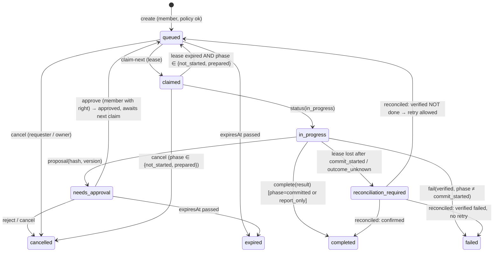

# 🤖 Muse Action Bridge: M0 design review (DESIGN ONLY, not authorized to build)

Status: **M0 package, stopped for independent review.** Nothing here is implemented:
- no endpoints, migrations, credentials, connector, deploy, merge, reservations or purchases.
- Implementation starts on `v2/muse-bridge` only after explicit approval.

**Names in this document.** Examples use **Sam**, the integration owner (whose Muse it is), and
**Pat**, an allowed requester. That follows the repository's naming rule. In the real household these
are the owner and his partner.

**Companion files:**
- `docs/muse/openapi.yaml`: the proposed REST shape.
- `docs/mockups/muse/screens.html` and `shoot.mjs`: the 390 px mockups, photographed into `out/`.

---

## 1. Architecture summary

Pawmily turns a request into a **bounded, minimal task**, applies **household policy**, and puts it
on a **per-family request queue**. Sam's Muse, configured once with a custom connector that points at
Pawmily's OpenAPI and a scoped bearer credential, **polls outbound** on a schedule:
1. claims the next eligible task with a lease;
2. does the real-world work with its own accounts and payment methods;
3. pauses for approval when policy says so;
4. writes progress and results back.

Pawmily shows them in the same Talk card and keeps an append-only audit trail.

```
Pat's / Sam's phone ──(Pawmily session)──▶ Worker /v2/agent/*  (user-authenticated)
                                               │ validate · minimise · authorise · route
                                               ▼
                                     ExternalActionRouter ──▶ MuseActionProvider
                                               │
                                               ▼
                                AgentHub (Durable Object, one per family, SQLite):
                                requests · events (append-only) · integration · policy
                                               ▲
Sam's Muse (scheduled task) ──(integration bearer, scoped)──▶ Worker /v2/agent/muse/*
                                                    claim-next · heartbeat · status · complete
```

**Principle:**
- Pawmily knows the family's context and decides what, who, whether and within what limits.
- Muse handles the outside world: websites, connected accounts, merchants and payment.
- Muse never reads Pawmily's family data. It reads only the tasks delegated to it.

## 2. Repo components to reuse (audited 2026-10-31 on `main` `9e6cb18`)

| Need | Reuse | Where |
| --- | --- | --- |
| HTTP routing, CORS, JSON errors | `familyApi` dispatch; a `agentRoutes()` module like `voiceRoutes` / `travelRoutes` | `server/family.js`, `server/worker.js` |
| Member auth and family scoping | Google sign-in, KV sessions, `loadFamily()` / `meIn()` membership checks, `relation: child` limits | `server/family.js` §4 of `docs/ARCHITECTURE.md` |
| Atomic, consistent per-family state | **Durable Object with SQLite**, like `ChatHub`: one per family (`idFromName(fid)`), single-threaded, so claim-next and leases are naturally atomic | `server/chatHub.js` |
| Rate limits | `underLimit(db, key, max, ttl)` | `server/family.js` |
| Notifications (approval needed, done) | `sendTo()` and `NOTIFY_KINDS` (add `agent`) | `server/push.js` |
| Talk intent → typed cards, approve-first | `js/talkParse.js` (phone reader), `tidySteps`, `js/talkActions.js` `ACTIONS` / `validate()` / `modeOf()`, `family/talk.js` cards, `go()` with Undo | |
| AI for the unusual phrasing (allowlisted fields, audit, no values logged) | `server/aiGateway.js` purposes (add `agent.task`) | |
| Minimum-context derivation from private data | the day-question pattern: the phone builds facts and the connector sees only what's needed (`js/talkDay.js`); free-time gaps already computed (`freeTime`) | |
| Signed, scoped, expiring tokens; secrets only on the connector | the speakable-ticket design on PR #19 (HMAC, purpose binding, nonce); the `wrangler secret` conventions | `server/voiceTts.js` (PR #19, unmerged) |
| Optional provider, master switch, one router | PR #19's `routeVoice`, master state and provider-neutral profile pattern | `family/voice.js`, `server/voiceTts.js` |
| Settings surfaces | Me tab sections (✨ Next up & reminders, 🔔 Notifications) for **Household Agent**; owner-only controls like the family's *Cloud voice* | `family/app.js` `meView` |
| Tests | `node --test` with in-memory KV/env, `familyApi` called directly (like `tests/voice.test.js`) | `tests/` |
| Deploy | Pages from `main`; Worker by `pawdeploy`; CI "Check" (tests, links, perf budget) | `CLAUDE.md` |

**Gaps found:**
- KV is last-write-wins, which is unfit for queues and leases. So the agent state lives in a Durable
  Object.
- The E2EE model needs one explicit, documented exception (§14).

## 3. Current Meta Muse custom-connector capabilities (verification, 2026-10-31)

Primary Meta pages could not be fetched from this session. `parallel.ai` and `cellcog.ai` are outside
the session's allowed network, and I did not retrieve Meta's Help Center page directly. These findings
come from search results, mostly third-party, and **must be re-verified in the Muse app and on Meta's
Help Center before M1**.

| Capability | Finding | Confidence |
| --- | --- | --- |
| Inbound API to invoke a person's Muse from outside | **None documented.** A third-party source states there is no public API for driving your Muse, adding connectors, or reading its skills from outside. | Medium (single source, consistent with all others) |
| Custom connectors | Created **by asking Muse in chat**: name the service and give an entry point, either **API docs/OpenAPI it can read** or a **remote MCP server URL**. No settings form. | Medium–high (several sources) |
| Credential handling | An API key given to a custom connector is kept in Muse's **Secure Credentials Store** and **not shown to the model**. | Medium |
| Meta review of custom connectors | **Not reviewed**: "grant access with caution". A separate **submission** path (`muse.ai/platform`, reported Sept 2026) is for public connectors. | Medium |
| MCP for consumer Muse | **Conflicting.** Some guides show remote MCP with OAuth; another says it is not officially confirmed. OpenAPI is consistently described as working. | Low–medium |
| Scheduled / background work | Meta's help page lists **recurring tasks (daily, weekly or custom interval)** that run in the background until cancelled. The minimum interval is **not stated**. | Medium |
| Usage limits | Usage is metered as **tokens per week**. Frequent polling consumes quota, and the real-world task capacity isn't published. | Low–medium |

**Verdict:**
- No better supported direct-invocation mechanism was found. The outbound polling design is the right
  assumption for now, so **no STOP on that criterion**.
- **Treat as uncertain until verified:**
  - the minimum polling interval;
  - whether a scheduled task can call a custom connector unattended;
  - whether Muse reliably follows a claim → heartbeat → complete protocol across one run;
  - whether Muse can wait for approval within one run, or must exit and resume on a later poll.

## 4. Can consumer Muse do the REST polling/claim flow?

**Probably yes, but this is undocumented as a protocol.** Muse can read an OpenAPI document, call
endpoints with a stored bearer key, and run recurring tasks. What is *not* documented:
- whether a scheduled run can call the connector without a person present;
- how many calls one run may make;
- how long a run may last.

The design therefore assumes the least:
1. **Each run is short and stateless.** Claim one task, work it as far as possible, write status, end.
   The next run resumes from Pawmily's stored state; no memory in Muse is required.
2. **Approval waits across runs.** Muse sets `needs_approval` and ends the run. A later run sees the
   approval (`claim-next` returns approved work first) and commits.
3. **Pawmily owns all safety:** leases, phases, constraints and reconciliation are enforced
   server-side. Muse's cooperation is required only for honest reporting.

**Verification step 0 (before writing code):** create a toy custom connector against a stub that
only logs calls (no family data), and observe:
- polling interval;
- unattended calls;
- call count per run;
- run duration.

## 5. Expected polling and background behaviour

- **Interval:** the shortest custom interval Muse allows. If that is 15 minutes, a coffee "in 20
  minutes" is borderline, and dinner bookings are fine.
- **What the UI says:** "Muse checks for requests about every N minutes", shown in Talk at send time,
  from `lastMusePollAt` statistics. It never promises immediacy.
- **Cost control:** `claim-next` returns **204 No Content** quickly when there's nothing to do. That
  keeps idle polls cheap in Muse tokens.
- **Manual nudge:** the card can say "To start now, open Muse and say 'check Pawmily'". That is plain
  text. **No undocumented `muse://` deep link** will be invented.
- **Presence:** `lastMusePollAt`, `lastMuseClaimAt` and `lastMuseSuccessAt` drive the status label:
  - "Muse connected" when polled within 2× the expected interval;
  - "Muse hasn't checked recently" after that;
  - "Muse not connected" if it never polled.

## 6. Credential storage

**Generation (owner only, in Household Agent settings):**
- 32 random bytes (`crypto.getRandomValues`), shown once as `pmk_<base64url>`.
- Stored only as `HMAC-SHA256(pepper, token)`, where the pepper is a Worker secret `AGENT_TOKEN_PEPPER`.
  It's kept in the integration record with a short non-secret `tokenHint` (the last 4 characters).
- Checked with a constant-time comparison.

**Use:**
- `Authorization: Bearer pmk_…` only, HTTPS only, on `/v2/agent/muse/*` routes.
- It is never accepted on member routes, and member session tokens are never accepted on Muse routes.

**On the Muse side:** the owner pastes the token into Muse's custom-connector setup. Muse keeps it in
its Secure Credentials Store (§3).

**Lifecycle:**
- `expiresAt` defaults to 90 days and is shown in settings.
- **Rotate** issues a new token; the old one is valid for 10 minutes, then dead.
- **Revoke** kills it immediately.
- **Disable integration** stops all Muse routes (403 `INTEGRATION_DISABLED`).
- Rate limit: 120 calls per hour per integration.

**Never logged:** `Authorization` headers, tokens, peppers or family keys. Errors carry codes only.

**Later:** if this ever serves many households, replace personal bearer tokens with OAuth, which
Muse reportedly supports for connectors.

## 7. REST vs MCP

**REST + OpenAPI first.**
- Consistently reported to work for consumer Muse custom connectors.
- Simple to test, and it fits the Worker.

**MCP later**, only if verification shows a practical gain (for example better unattended behaviour).
It would be a thin adapter over the **same `AgentRequestService`** (`claim_next_request`,
`get_request`, `heartbeat_request`, `update_request`, `complete_request`, `fail_request`), with one
state machine, one validator, one store and one audit log.

## 8. ExternalActionProvider design

```
interface ExternalActionProvider {
  id: 'muse' | 'direct' | 'none'
  capabilities(): RequestType[]                 // what it can execute
  available(integration): { ok, why }           // enabled, not revoked, recently polled
  submit(request): void                         // Muse: enqueue (pull model); Direct: call merchant API
}
ExternalActionRouter.route({ requestType, requester, beneficiaries, prefs })
  → { provider, integrationId } | { provider: 'none', why }
```

- **Talk asks only `route()`**, never "Muse". With one integration it is picked automatically when
  policy allows, so you never choose an agent each time.
- **Fallbacks when no provider is available:**
  - "Household Agent unavailable", with the reason in plain words;
  - Talk and every other feature keep working;
  - optionally "Open in Muse" as plain advice, never an invented link.
- **Future:** a `DirectAPIProvider` for a restaurant with a booking API slots in without touching Talk
  or `AgentRequest`.

## 9. ExternalAgentIntegration model

```jsonc
{
  "id": "int_7k2…", "familyId": "fam…", "provider": "muse",
  "ownerMemberId": "m_sam", "allowedRequesterMemberIds": ["m_sam", "m_pat"],
  "enabled": true,
  "scopes": ["agent.requests.read", "agent.requests.claim", "agent.requests.update", "agent.requests.complete"],
  "policy": { /* §13 */ },
  "tokenHash": "…", "tokenHint": "…x9Qa", "tokenExpiresAt": "2027-01-29T…",
  "presence": { "lastMusePollAt": null, "lastMuseClaimAt": null, "lastMuseSuccessAt": null },
  "createdAt": "…", "updatedAt": "…", "expiresAt": null, "revokedAt": null, "version": 3
}
```

- Stored in the family's `AgentHub` Durable Object.
- Only the owner can change it. Allowed requesters can read its name, status and what they're allowed
  to do.
- Children are never allowed requesters.

## 10. AgentRequest schema (v1)

```jsonc
{
  "id": "req_…", "schemaVersion": 1, "idempotencyKey": "<client uuid>",
  "requestType": "dinner_reservation",            // dinner_reservation | coffee_order | external_research | shopping_purchase | general_external_action
  "instruction": "Book dinner for two near Santana Row on Saturday evening.",   // human-readable, minimal
  "parameters": {                                  // validated per type (see below)
    "partySize": 2, "date": "2026-11-07", "earliestTime": "18:00", "latestTime": "19:30",
    "area": "Santana Row, San Jose", "cuisine": "Greek", "reservationOwner": "integration_owner"
  },
  "constraints": { "maxPricePerPerson": 100 },      // structured; enforced for preauthorized commits
  "approvalPolicy": "ask_before_commit",            // report_only | ask_before_commit | preauthorized_within_constraints
  "status": "queued", "executionPhase": "not_started",
  "priority": 0,
  "requestedByMemberId": "m_pat", "requestedForMemberIds": ["m_pat", "m_sam"],
  "integrationId": "int_7k2…",
  "createdAt": "…", "updatedAt": "…", "expiresAt": "2026-11-07T01:30:00Z",
  "lease": { "owner": "muse:int_7k2", "token": "<hash only>", "expiresAt": "…" }, "attemptCount": 0,
  "proposal": null, "approval": null,
  "resultSummary": null, "resultData": null, "externalReference": null,
  "errorCode": null, "errorMessage": null,
  "visibility": "shared",                           // requester | shared (requestedFor) | owner_light
  "version": 1
}
```

**Per-type parameters (validated server-side; unknown keys dropped):**

| Type | Parameters |
| --- | --- |
| `coffee_order` | `store` (name/area), `items[]` {name, size?, milk?, temp?, qty ≤ 4}, `pickupAfter`/`pickupBy` (HH:MM), `forMember` (`requester`) |
| `dinner_reservation` | `partySize` (1–8), `date`, `earliestTime`, `latestTime`, `area`, `restaurant?`, `cuisine?`, `reservationOwner` (`integration_owner` or `requester`) |
| `external_research` | `question` (≤ 500 chars), `area?`, `when?`; report only |
| `shopping_purchase` | `item` (≤ 200), `qty`, `maxTotal`, `deliverTo` (`home`), `needBy?` |
| `general_external_action` | `instruction` only; always `report_only` or `ask_before_commit` |

**Never in a request:**
- card numbers, passwords, family keys or session tokens;
- health data;
- threads or notes;
- calendar dumps or names beyond what the action needs.

The validator rejects strings that look like cards, codes or passwords (reusing the
`looksSensitive`-style patterns from PR #19).

## 11. Request state machine



**Rules:**
- Every mutation carries `version` (optimistic concurrency → `409 VERSION_CONFLICT`).
- Every Muse mutation carries the current lease token (`403 NOT_LEASE_HOLDER`).
- Terminal states are `completed`, `failed`, `cancelled` and `expired`. Nothing leaves them.
- An illegal transition returns `409 INVALID_TRANSITION`.

## 12. Execution phase and reconciliation

`executionPhase` runs alongside `status`:

```
not_started → prepared → commit_started → committed
                              │
                              └→ outcome_unknown → (reconciliation) → committed | verified_not_committed
```

- **Before any irreversible step**, Muse must call `POST …/commit-intent` with the **proposal hash it
  is about to execute**. The server records `commit_started` atomically, and only if:
  - the lease is valid;
  - the request isn't cancelled or expired;
  - the integration is enabled;
  - an approval for that exact hash exists, or the preauthorized constraints pass server-side.
- **A lease that expires after `commit_started` never requeues.** The request goes to
  `reconciliation_required`, and `claim-next` hands it back as a reconciliation task ("check whether
  booking X exists"), not as a fresh booking.
- **Reconciliation outcomes:**
  - `confirmed` (with external reference) → `completed`;
  - `verified_not_committed` (Muse checked the merchant; nothing exists) → back to `queued` for a new
    attempt, which needs a new commit-intent;
  - `unverifiable` → stays `reconciliation_required` and asks the requester and owner to check
    manually.
- **Cancelling after `commit_started`** is not a status flip. It becomes a cancellation request that
  Muse must carry out with the merchant, and the UI says so.
- **Merchant idempotency is not assumed.** Pawmily's `idempotencyKey` stops duplicate *requests*,
  and the commit-intent gate plus reconciliation stop duplicate *executions* as far as reasonably
  possible.

## 13. Household authorization model

**Three identities per request:** requester (`requestedBy`), integration owner (whose Muse and card),
and beneficiaries or affected members (`requestedFor`).

```jsonc
"policy": {
  "coffee_order":       { "requesters": ["m_sam", "m_pat"], "mode": "preauthorized_within_constraints",
                          "limits": { "maxTotal": 12 },               // configurable, not hard-coded
                          "ownerApproval": "above_limit" },
  "dinner_reservation": { "requesters": ["m_sam", "m_pat"], "mode": "ask_before_commit",
                          "shared": "either_partner_within_constraints",
                          "limits": { "maxPartySize": 6, "maxPricePerPerson": 120 } },
  "shopping_purchase":  { "requesters": ["m_sam", "m_pat"], "mode": "ask_before_commit",
                          "ownerApproval": "always" },
  "external_research":  { "requesters": ["m_sam", "m_pat"], "mode": "report_only" },
  "general_external_action": { "requesters": ["m_sam"], "mode": "ask_before_commit" }
}
```

**At create time**, the server checks:
1. the requester is a member and listed for that type;
2. the beneficiaries are members, and a shared action follows its `shared` rule;
3. the integration is enabled and not revoked;
4. the parameters are valid.

**At commit time**, the server re-checks policy against **today's** settings. A request created
before Pat lost access may still finish if it already reached `commit_started`. If it hasn't, it
moves to `cancelled` with reason `permission_removed`.

**Who approves:**
- Requester approval applies when the mode is `ask_before_commit`.
- Owner spending approval applies when `ownerApproval` triggers.
- These are separate records, and both may be needed. For example, Pat asks for a $250 purchase:
  Pat confirms, then Sam approves the spend.

**Approval is bound to the exact proposal.** It records `{proposalHash, proposalVersion,
approvedBy, at}`. Any material change produces a new hash, and the earlier approval is void. Material
details are the place, date, time, party size, items, quantity, price or total, pickup time and
cancellation terms.

**Pawmily approval doesn't bypass Muse's own checks.** Muse may still ask Sam to confirm in Muse;
that is expected.

**Results visibility:**
- Coffee: the requester sees details; Sam sees "Pat ordered a coffee" only if
  `ownerActivity: "light"`.
- Dinner: both partners see the reservation, with no payment details.

## 14. Privacy and data flow

```
Phone (decrypted family data; family key never leaves)
  │ derive minimum task (on the phone, or allowlisted fields via aiGateway `agent.task`)
  │   e.g. free gaps → "18:00–19:30 Sat", party 2, area — NOT the calendar
  ▼
Worker (plaintext AgentRequest: only the bounded task)  ◀── explicit, documented E2EE exception
  │   stored in AgentHub DO; audit = ids, types, statuses, hashes, safe result fields
  ▼
Muse (custom connector, scoped bearer) — sees ONLY delegated AgentRequests + its own results
  │
  ▼ merchant sites / payment (Muse's own accounts; Pawmily never sees cards or sessions)
```

- **Not end-to-end encrypted, by necessity:** Muse must read the task. The privacy page would say
  plainly that a Household Agent request is readable by the connector and by Sam's Muse.
- **Minimisation:**
  - roles instead of names where possible (`reservationOwner: integration_owner`);
  - party size instead of guest names;
  - a time window instead of the calendar.
- **No general access:** no Muse route reads families, members, health, threads, calendar, Watch,
  Read, Look or files. Tests prove each is denied (§19).

## 15–18. Mockups (390 px)

All in `docs/mockups/muse/`; `node docs/mockups/muse/shoot.mjs` photographs them into `out/`.

| # | Screen | Shows |
| --- | --- | --- |
| 15 | `#handoff` | Talk → Muse handoff, with the same card updating through *Sent to Muse → Muse is working on it… → ✓ Coffee ordered* |
| 16 | `#approve` | Muse's proposal, with **Approve reservation / Change / Cancel**, its hash bound, and "Muse may still ask you to confirm in Muse" |
| 17 | `#history` | **Household Agent activity** in Me: Needs approval / Active / Done / Needs checking (reconciliation) / Failed / Cancelled |
| 18 | `#settings` | **Household Agent** settings: Sam's Muse, who can use it, action policies, approval rules, credential (generate once, rotate, revoke), connection status |

None of these adds a bottom tab. The entry point is Talk, and history and settings live under Me.

## 19. Rollout and test strategy

**Automated tests**, in `tests/agent*.test.js`, using in-memory env, a Durable Object stub and fake
timers:
- **Auth:** missing, invalid, expired or revoked credential; insufficient scope; a member token on a
  Muse route and vice versa; cross-family access; unauthorized requester; child requester.
- **Create:** a valid request per type; schema errors; unknown type; idempotent duplicate (same key →
  same request); expired; sensitive-pattern rejection; a minimised payload has no names or keys.
- **Claim:**
  - claim-next picks the highest priority and approved work first;
  - two concurrent claims → one wins;
  - lease issued and ownership enforced;
  - lease expiry before commit → requeued, `attemptCount`+1;
  - heartbeat extends, capped by expiry, cancel or revoke.
- **Execution safety:**
  - commit-intent requires a valid lease and an approval or constraints;
  - lease expiry after `commit_started` → `reconciliation_required`, **never requeued**;
  - `outcome_unknown` path;
  - retry only after `verified_not_committed`;
  - cancel after `commit_started` → cancellation request, not a status flip.
- **Transitions:** the full legal matrix, every illegal one → 409; version conflict → 409; cancelled
  and completed requests can't be claimed or recommitted.
- **Approval:**
  - only the right member approves;
  - an unauthorized approval → 403;
  - hash/version binding, so a changed proposal voids the approval;
  - preauthorized inside constraints commits, and outside → `needs_approval`;
  - owner spending approval is separate from requester approval.
- **Results:** completion and failure writeback; external reference; requester-only vs shared
  visibility; owner-light activity.
- **Privacy and security:**
  - console capture shows no tokens, Authorization headers or payment fields;
  - every non-agent route is denied with the integration token;
  - the audit log has no secrets.
- **Optional:**
  - integration disabled or credential missing → Talk still works, with no queue writes;
  - the rest of the app is unaffected.

**Real-world rollout** (from the brief; no real purchases until stage 4):
- **Stage 0:** Muse connector smoke test against a logging stub, no family data (§4).
- **Stage 1:** `external_research` report-only ("three dinner options near Santana Row").
- **Stage 2:** a prepared reservation → `needs_approval` → approve → Muse observes the approval, with
  **no booking**.
- **Stage 3:** a real reservation under `ask_before_commit`.
- **Stage 4:** coffee under `preauthorized_within_constraints` (≤ configured limit), from Sam, then
  from Pat through Sam's Muse.

## Implementation plan (after approval, on `v2/muse-bridge`; PR stays unmerged for review)

1. **`AgentHub` Durable Object:** schema and migrations, `AgentRequestService` (pure state machine and
   validators in `js/agentRequest.js`, shared by REST and any future MCP adapter), audit table.
2. **Integration and credential:** generate, hash, rotate, revoke, scopes, presence.
3. **Muse routes:** `claim-next`, heartbeat, status/proposal, `commit-intent`, complete, fail,
   reconcile. **Member routes:** create, list, get, approve, reject, cancel. OpenAPI served at
   `/v2/agent/openapi.json`.
4. **Router and providers:** `ExternalActionRouter`, `MuseActionProvider`, `NoneProvider`.
5. **Talk:**
   - phone-read intents (`coffee_order`, `dinner_reservation`) plus aiGateway `agent.task` for the
     rest;
   - minimum-context derivation;
   - a live card that polls `GET /v2/agent/requests/{id}` while open, plus a push notification on
     approval or completion.
6. **Me:**
   - Household Agent settings and activity;
   - privacy page, README, help, ARCHITECTURE and server README updates.
7. **Run the stages** in §19, Stage 0 first.

Steps 1–3 need a Worker deploy (`pawdeploy`) when eventually merged. The front end needs Pages. Neither
happens without approval.

## 20. Unresolved Muse and platform questions

1. **Minimum scheduled-task interval** for consumer Muse, and whether it changes by plan.
2. **Unattended connector calls:** can a recurring task call a custom connector with no person in the
   chat?
3. **Run budget:** calls per run, maximum run duration, weekly token use per idle poll.
4. **Protocol fidelity:** will Muse follow claim → heartbeat → commit-intent → complete reliably from
   an OpenAPI description plus instructions, or does it need an MCP tool surface?
5. **Approval wait:** can one run wait for approval, or must it end and resume?
6. **Auth options for custom connectors:** bearer API key (assumed), OAuth, or both. Confirm the
   Secure Credentials Store behaviour.
7. **Commerce confirmations:** Muse's own purchase or booking confirmation prompts. These are
   expected and not bypassed, but how do they appear when the task was started by a schedule?
8. **Reconciliation capability:** can Muse reliably check an existing booking or order on the
   merchant site (OpenTable history, a coffee app's order list)?
9. **Is there a supported "open Muse with this message" link?** None found; none will be invented.
10. **Data retention on Meta's side** for task text Muse reads; this belongs in the privacy page.
